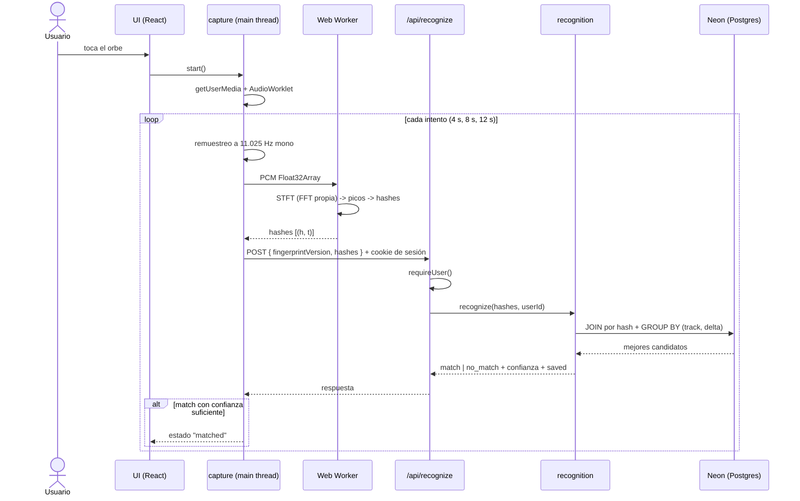
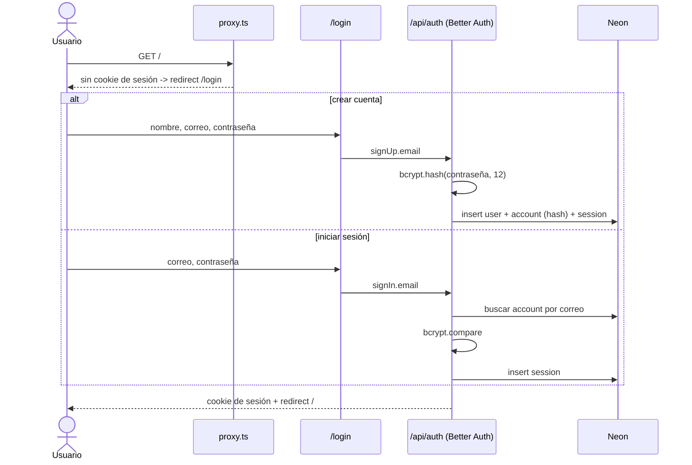
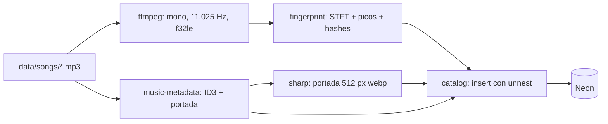

# Arquitectura

## Estilo: monolito modular

Una sola aplicación Next.js (App Router) y un solo despliegue. Por dentro, el código se divide en **módulos de servicio** con API pública explícita y reglas de dependencia verificadas por el linter. Esto da la simplicidad operativa de un monolito con la separación de responsabilidades de los microservicios.

## Mapa de módulos

| Módulo | Responsabilidad | Dónde corre | Depende de |
|---|---|---|---|
| `dsp` | FFT, DFT de referencia, ventanas, STFT, espectrograma | Navegador y Node (isomórfico, puro) | nada |
| `fingerprint` | Detección de picos y generación de hashes | Navegador y Node (isomórfico, puro) | `dsp` |
| `capture` | Micrófono, grabación, remuestreo a 11.025 Hz, Web Worker, espectro en vivo | Solo navegador | `fingerprint`, `dsp`, `shared` |
| `db` | Cliente Drizzle, esquema completo y migraciones | Solo servidor | `shared` |
| `auth` | Better Auth (correo y contraseña, hash bcrypt), sesión, `requireUser()` | Servidor (+ entrada `auth/client` para el navegador) | `db`, `shared` |
| `catalog` | Tracks, portadas y fingerprints; consulta de candidatos | Solo servidor | `db`, `shared` |
| `recognition` | Caso de uso: hashes de consulta -> canción + confianza | Solo servidor | `catalog`, `fingerprint` (solo tipos y versión), `shared` |
| `library` | Guardadas y playlists por usuario | Solo servidor | `db`, `catalog`, `shared` |
| `shared` | Tipos comunes, contratos zod, configuración, errores | Ambos | nada |
| `app/` | Rutas de UI, route handlers y server actions (capa delgada) | Ambos | cualquier módulo vía su entrada pública |
| `scripts/ingest` | CLI de ingesta de la carpeta de canciones | Node local | `fingerprint`, `catalog`, `db` |

**Idea clave**: `dsp` y `fingerprint` son TypeScript puro sin APIs del navegador ni de Node. El mismo código genera los fingerprints de las canciones (en el script de ingesta) y los de la grabación (en el navegador), lo que garantiza que ambos lados calculen exactamente lo mismo.

## Estructura de carpetas

```
kazammi/
├── CLAUDE.md                     # reglas para Claude Code
├── specs/                        # fuente de verdad (SDD)
├── public/brand/                 # logo (ver 08-ui/design-references.md)
├── src/
│   ├── proxy.ts                  # redirección a /login sin sesión (middleware.ts en Next < 16)
│   ├── app/
│   │   ├── login/page.tsx
│   │   ├── (app)/                # grupo protegido por sesión
│   │   │   ├── layout.tsx        # requireUser() + header con avatar
│   │   │   ├── page.tsx          # identificar
│   │   │   ├── saved/page.tsx    # Guardadas
│   │   │   ├── playlists/page.tsx
│   │   │   ├── playlists/[id]/page.tsx
│   │   │   └── how-it-works/page.tsx
│   │   ├── _components/
│   │   └── api/
│   │       ├── auth/[...all]/route.ts
│   │       ├── recognize/route.ts
│   │       ├── tracks/[id]/cover/route.ts
│   │       └── health/route.ts
│   ├── modules/
│   │   ├── dsp/  fingerprint/  capture/
│   │   ├── db/  auth/  catalog/  recognition/  library/
│   └── shared/
├── scripts/
│   ├── ingest/                   # CLI de ingesta
│   └── eval/                     # evaluación offline (métricas del informe)
├── drizzle/                      # migraciones SQL
└── data/                         # (gitignored) songs/, songs-holdout/
```

## Reglas de dependencia

1. Un módulo solo se importa a través de su `index.ts`. Única excepción: `@/modules/auth/client` para el cliente de auth en el navegador.
2. `dsp` y `fingerprint` no importan nada de React, Next, `window`, `fs` ni de otros módulos (salvo `fingerprint -> dsp`).
3. `db`, `auth` (entrada de servidor), `catalog`, `recognition` y `library` incluyen `import "server-only"`; `capture` incluye `import "client-only"`.
4. La UI nunca llama a `dsp` o `fingerprint` directamente: consume el hook `useRecognizer()` de `capture`. Excepción: la vista explicativa, que usa los datos de depuración que expone el hook.
5. **Toda** función de `library` recibe el `userId` desde `requireUser()` en el servidor; nunca desde el cliente.
6. Las reglas 1 y 2 se verifican con ESLint (`eslint-plugin-boundaries` y `no-restricted-globals`) en CI. La regla 3 la garantizan los paquetes `server-only` y `client-only`, que rompen el build si se importan en el lado equivocado.

## Flujo de reconocimiento



## Flujo de autenticación



## Flujo de ingesta



La ingesta **nunca** corre en Vercel: se ejecuta en la PC contra la rama de Neon que corresponda.

## Decisiones de arquitectura (ADR resumidas)

| # | Decisión | Alternativas descartadas | Motivo |
|---|---|---|---|
| ADR-1 | Monolito modular en Next.js | Microservicios, backend separado en Python | Un solo despliegue, un solo lenguaje, menos infraestructura para una demo |
| ADR-2 | FFT propia en TypeScript | fft.js, AnalyserNode de Web Audio | Valor académico: el código es la demostración del modelo matemático |
| ADR-3 | Fingerprint calculado en el navegador | Enviar el audio al servidor | Payload pequeño (~50 KB vs ~250 KB), no se sube audio del usuario, la UI puede mostrar el espectrograma |
| ADR-4 | PostgreSQL en Neon | SQLite/Turso, Supabase | Postgres real con plan gratuito, ramas por entorno e integración con Vercel |
| ADR-5 | Agregación del histograma en SQL | Traer filas y agregar en JS | Menos datos entre Neon y la función serverless; verificado con índice cubriente (index-only scan) |
| ADR-6 | Carpeta local de canciones de prueba | Dataset FMA, APIs externas | Catálogo pequeño y conocido por el público; el audio no se publica |
| ADR-7 | `fingerprintVersion` en cada consulta | Ninguna | Si cambian los parámetros del fingerprint, el servidor rechaza consultas incompatibles |
| ADR-8 | Vercel para el despliegue | AWS (App Runner/ECS) | Integración nativa con Next.js y Neon, HTTPS automático |
| ADR-9 | Correo y contraseña con bcrypt, sesiones con Better Auth | OAuth (Google/GitHub), auth hecha a mano, Clerk | Sin registrar apps en proveedores externos; Better Auth resuelve cookies, sesiones y rate limit; los datos quedan en nuestra base |
| ADR-10 | Driver `postgres` (postgres.js) en la app y los scripts; PGlite en tests | `@neondatabase/serverless` | Un solo driver para Neon y Postgres local, con transacciones; PGlite da Postgres real en memoria para los tests sin Docker |
| ADR-11 | Guardadas como tabla propia y FK compuesta desde las playlists | Guardadas como una playlist más | La base garantiza que toda canción de una playlist esté en Guardadas y que quitarla de Guardadas la quite de todas |
| ADR-12 | Portadas en Postgres (`bytea`, 512 px webp) | Vercel Blob, archivos en `public/` | Catálogo pequeño; no hay otro servicio ni imágenes con derechos en el repo |

## Restricciones conocidas

- **Neon, plan gratuito**: 1 GB de almacenamiento por proyecto, 100 CU-hora por proyecto, 5 GB de transferencia. El cómputo **se suspende tras 5 minutos sin uso** y la primera consulta lo despierta con algo de latencia: antes de presentar, abrir la app o llamar `/api/health`.
- **Tamaño por canción**: una canción completa de ~3,5 min genera ~45.000 filas de fingerprint, ~3,5 MB en Postgres. Con 1 GB caben unas 250 canciones (ver `math-model.md` sección 9).
- **Micrófono**: `getUserMedia` exige HTTPS (o `localhost`).
- **Sin envío de correos**: no hay verificación de correo ni recuperación de contraseña en v1.
