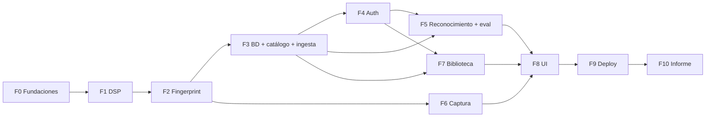

# Roadmap

Fases en orden de implementación. Cada fase termina en un **hito verificable** y no se pasa a la siguiente sin cumplirlo. El esfuerzo se estima en sesiones de trabajo de ~2 h.



| Fase | Specs | Hito verificable | Esfuerzo |
|---|---|---|---|
| **F0 Fundaciones** | 00, 01 | Specs aprobadas; `npm run lint && npm run typecheck && npm test && npm run build` pasan en CI | 2 |
| **F1 DSP** | 02 | FFT propia coincide con la DFT (error < 1e-9) para N = 2 a 4096; STFT ubica una senoidal en el bin esperado | 2 |
| **F2 Fingerprint** | 03 | Señal sintética genera hashes deterministas; la misma señal desplazada genera los mismos hashes con offset constante | 2 |
| **F3 BD + catálogo + ingesta** | 04, 05 | Rama `dev` de Neon con las canciones de `data/songs/` indexadas, con portada; tamaño por canción medido | 3 |
| **F4 Auth** | 10 | En `localhost`, crear cuenta e iniciar sesión funcionan con hash bcrypt; sin sesión toda ruta redirige a `/login` | 2 |
| **F5 Reconocimiento + eval** | 06 | `POST /api/recognize` (con sesión) reconoce segmentos de 10 s; el script de evaluación reporta precisión con ruido | 3 |
| **F6 Captura** | 07 | En `localhost`, el hook graba del micrófono, produce hashes en un Web Worker y reconoce una canción del parlante | 2 |
| **F7 Biblioteca** | 11 | Guardar, quitar, crear playlist, agregar y quitar canciones funcionan con tests sobre PGlite | 2 |
| **F8 UI** | 08 | Flujo completo login -> identificar -> guardar -> playlist con el diseño de las referencias; vista explicativa | 4 |
| **F9 Deploy** | 09 | App en Vercel + Neon `main`; criterios V-1, V-2, V-3 y V-6 cumplidos en el celular | 1 |
| **F10 Informe** | 06 (eval) | Tablas de precisión vs. SNR y duración, figuras de espectrograma, constelación e histograma exportadas para el IEEE | 1 |

**Total estimado**: ~24 sesiones. F1 y F2 son el corazón matemático: si el tiempo aprieta, se recortan primero la vista explicativa (S) y la edición avanzada de playlists (renombrar, reordenar), nunca la FFT propia.

## Ruta crítica para la presentación

F0 -> F1 -> F2 -> F3 -> F4 -> F5 -> F6 -> F7 (guardar + una playlist) -> F8 (sin vista explicativa) -> F9.

## Plan B para el día de la presentación

- Abrir la app unos minutos antes para despertar el cómputo de Neon.
- Tener la sesión ya iniciada en el celular y en el portátil.
- Grabar un video de la demo funcionando (por si falla el wifi o el micrófono del salón).
- Tener la app corriendo también en `localhost` contra la rama `dev` de Neon.
- Llevar las canciones de prueba en el celular para reproducirlas frente al micrófono.

## Mensajes de commit por fase (resumen)

Los mensajes exactos están en cada `tasks.md`. Vista rápida:

```
docs(specs): add initial sdd specs and project roadmap           # F0
chore(platform): scaffold next.js app with typescript strict      # F0
feat(dsp): add iterative radix-2 fft with bit-reversal            # F1
feat(fingerprint): add band-based spectral peak picking           # F2
feat(db): add drizzle schema and migrations for neon              # F3
feat(ingest): add local songs ingestion cli                       # F3
feat(auth): add email and password auth with bcrypt              # F4
feat(recognition): add offset histogram matching                  # F5
feat(capture): record microphone audio with audioworklet          # F6
feat(library): add saved tracks and custom playlists              # F7
feat(ui): add identify screen with recognition states             # F8
build(deploy): configure vercel and neon for production           # F9
feat(eval): export figures and metrics for ieee report            # F10
```
