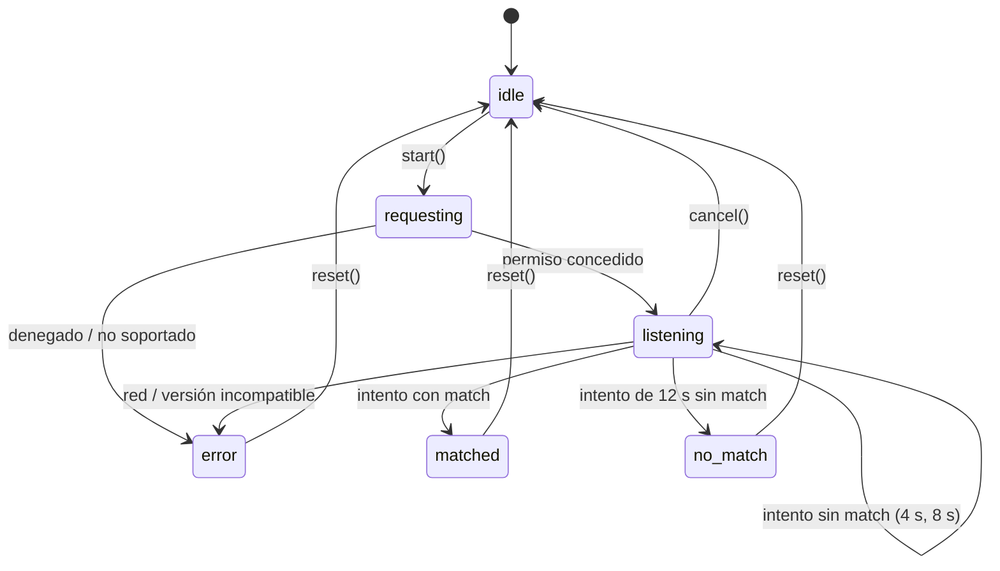

# 07 Capture: diseño

## Máquina de estados



`listening` incluye un subcampo `attempt: 0 | 1 | 2 | 3` y `processing: boolean` para que la UI muestre el progreso.

## API pública (`src/modules/capture/index.ts`)

```ts
export type RecognizerState =
  | { status: "idle" }
  | { status: "requesting" }
  | { status: "listening"; elapsedMs: number; attempt: number; processing: boolean }
  | { status: "matched"; result: MatchResult }
  | { status: "no_match"; bestScore: number }
  | { status: "error"; reason: "permission_denied" | "unsupported" | "insecure_context" | "network" | "unauthorized" | "version_mismatch" | "unknown" };

export interface RecognizerLive {
  level: number;              // RMS 0..1
  spectrum: Float32Array;     // magnitudes en dB normalizadas 0..1, 128 bandas
}

export interface RecognizerDebug {
  waveform: Float32Array;     // PCM 11.025 Hz reducido a ~2.000 puntos (min/max por bloque)
  spectrogram: Spectrogram;
  peaks: Peak[];
  histogram?: Array<[delta: number, count: number]>;
}

export function useRecognizer(): {
  state: RecognizerState;
  live: RecognizerLive | null;     // se actualiza por requestAnimationFrame
  debug: RecognizerDebug | null;
  start(): void;
  cancel(): void;
  reset(): void;
};
```

## Piezas

| Pieza | Hilo | Responsabilidad |
|---|---|---|
| `public/worklets/recorder.js` | Audio | `AudioWorkletProcessor` que envía bloques de 128 muestras al hilo principal por `port.postMessage` |
| `recorder.ts` | Principal | `getUserMedia`, `AudioContext`, conexión del worklet, buffer acumulado |
| `resample.ts` | Principal | `OfflineAudioContext(1, length·11025/sr, 11025)` para remuestrear con el filtro del navegador |
| `fingerprint.worker.ts` | Worker | Recibe PCM 11.025 Hz, llama a `fingerprint()`, devuelve hashes (transferibles) y debug opcional |
| `api-client.ts` | Principal | `POST /api/recognize` con el contrato zod compartido (la cookie de sesión viaja sola por ser mismo origen); 401 -> `unauthorized` |
| `live-analyser.ts` | Principal | FFT propia de 1024 puntos sobre las últimas muestras, agrupada en 128 bandas logarítmicas |
| `machine.ts` | Principal | Reductor puro de la máquina de estados (testeable sin navegador) |
| `use-recognizer.ts` | Principal | Hook que conecta todo |

- El worklet va en `public/` como JavaScript plano porque `audioWorklet.addModule()` necesita una URL y así se evita depender del bundler.
- El worker se crea con `new Worker(new URL("./fingerprint.worker.ts", import.meta.url), { type: "module" })`, patrón soportado por Next.js. Se verifica en la tarea correspondiente.
- Los `Uint32Array` de hashes se devuelven como transferibles para no copiarlos.

## Intentos acumulativos

```
t = 4 s  -> fingerprint(audio[0:4 s])  -> API -> ¿match? fin
t = 8 s  -> fingerprint(audio[0:8 s])  -> API -> ¿match? fin
t = 12 s -> fingerprint(audio[0:12 s]) -> API -> match | no_match
```

Si un intento sigue en curso cuando llega el siguiente, se espera a que termine (no se lanzan intentos en paralelo).

## Diferencia con la ingesta

La ingesta remuestrea con ffmpeg y el navegador con `OfflineAudioContext`. Los filtros no son idénticos, pero los picos espectrales dominantes no cambian. El fingerprint es robusto a esa diferencia por diseño; se comprueba en la prueba con micrófono real (criterio V-1).
