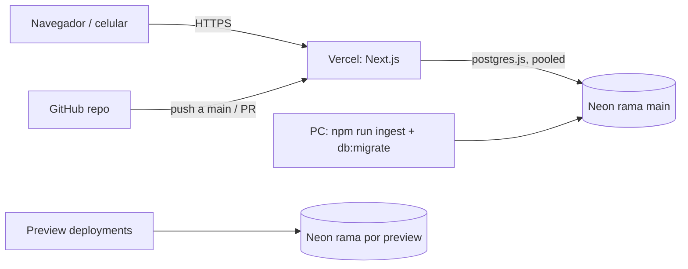

# 09 Deploy: diseño

## Topología

## Ramas de Neon

| Rama | Uso | Contenido |
|---|---|---|
| `main` | Producción | Catálogo completo + usuarios reales |
| `dev` | Desarrollo local y evaluación | Catálogo + usuarios de prueba |
| `preview/*` | Preview deployments (S) | Copia de `main` creada por la integración Neon-Vercel |

Neon crea las ramas por copia instantánea (copy-on-write), así que una rama de preview ya trae el catálogo sin volver a indexar.

## Pasos

1. **Vercel**: importar el repo de GitHub (Next.js se detecta solo).
2. **Neon**: conectar el proyecto existente con la integración de Neon para Vercel, o cargar `DATABASE_URL` a mano con la cadena *pooled* de `main`. Si se usa la integración, activar la creación de ramas para previews (DEP-R7).
3. **Variables de entorno** de Production: `DATABASE_URL`, `BETTER_AUTH_SECRET` (distinto al de desarrollo) y `BETTER_AUTH_URL=https://<dominio-prod>`.
4. **Región**: fijar la región de funciones igual o cercana a la de Neon (p. ej. `iad1` para `us-east-1`).
5. **Runtime**: route handlers con `export const runtime = "nodejs"` (postgres.js y bcryptjs).
6. **Migraciones y catálogo**: desde la PC, con `DATABASE_URL` apuntando a `main`: `npm run db:migrate` y luego `npm run ingest`.
7. Verificar `/api/health`, crear una cuenta y probar el flujo completo desde el celular.

## Login en previews (S)

Las URLs de preview cambian en cada deploy. En previews no se define `BETTER_AUTH_URL`: la URL base se arma con la variable `VERCEL_URL` que Vercel inyecta, y el dominio de preview se agrega a `trustedOrigins` de Better Auth. Como no hay OAuth, no hace falta registrar nada en terceros.

## Actualizar el catálogo

Si cambia `FINGERPRINT_VERSION`: `npm run ingest -- --reset` contra `main` y redeploy. `--reset` solo regenera `fingerprints` y conserva `tracks`, así las Guardadas y playlists de los usuarios no se pierden (ver ING-R11). Agregar canciones nuevas no requiere reset.

## Límites a vigilar

| Servicio | Límite relevante (plan gratuito) | Cómo se mitiga |
|---|---|---|
| Neon | 1 GB por proyecto, 100 CU-hora, se suspende tras 5 min sin uso | Catálogo de decenas de canciones; despertar antes de presentar con `/api/health` |
| Vercel Hobby | Uso no comercial; límites de ejecución de funciones | Proyecto académico; una consulta SQL por intento |

Los límites se revisan en las páginas oficiales de precios antes de desplegar, porque cambian.

## Alternativa futura (C)

`output: "standalone"` en `next.config` + `Dockerfile` multi-stage, para desplegar en un contenedor (AWS App Runner, Fly.io o similar). Útil para el portafolio de DevOps, no necesario para la presentación.
